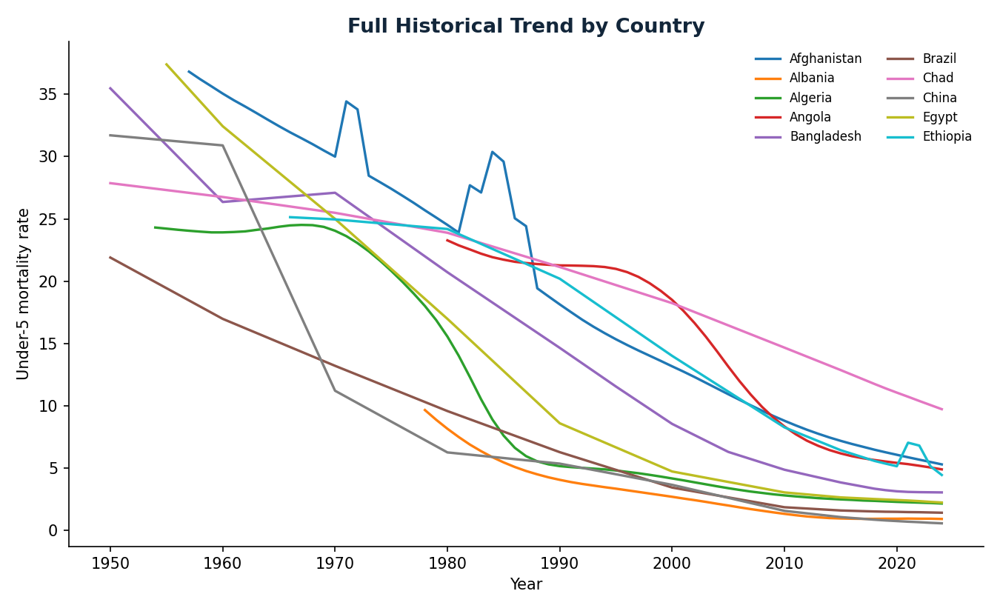
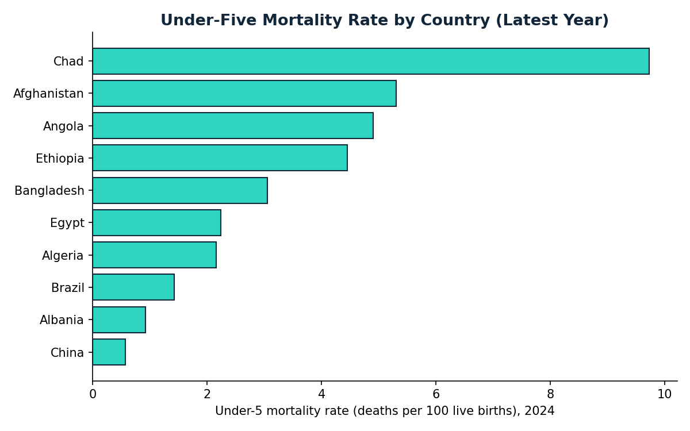
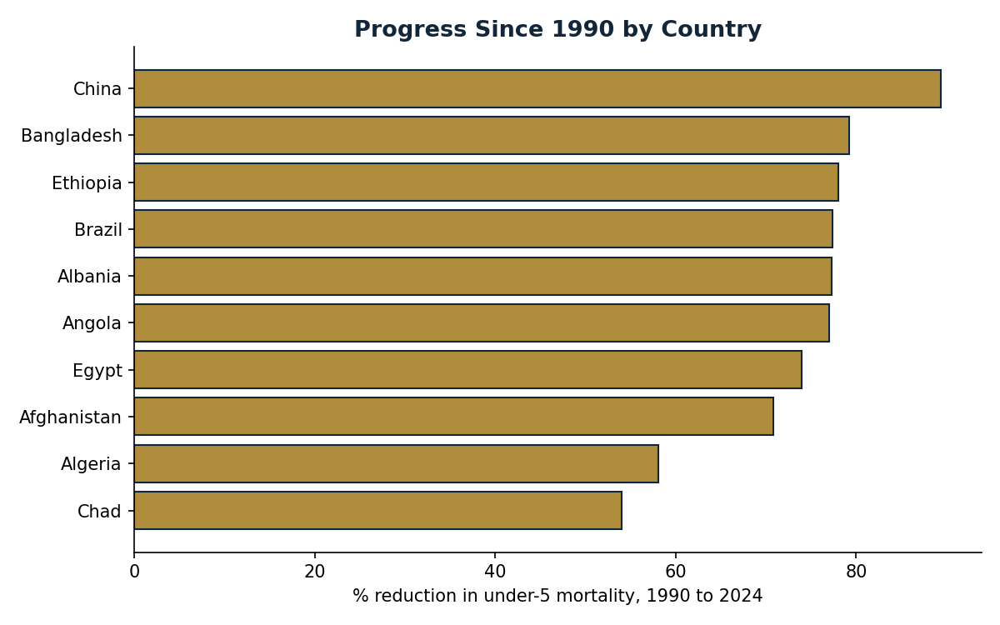
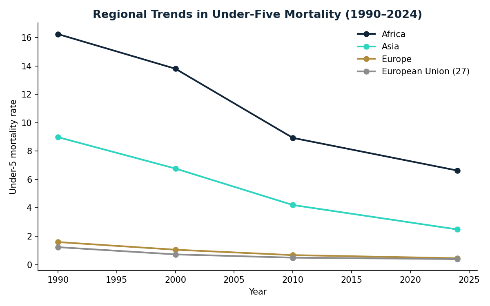

# Under-Five Mortality | Data Cleaning, SQL & Visualization

**Python · SQLite · Public-health data · Data storytelling**

I used this project to practice a complete data-analysis workflow on a subject where the numbers really matter: **how under-five mortality has changed over time, and how progress differs between countries and regions**.

I worked with a public dataset sourced through [Our World in Data](https://ourworldindata.org/grapher/child-mortality), drawing on estimates from **UN IGME** (the UNICEF-led inter-agency group) and historical Gapminder data. This is a personal portfolio exercise, **not work completed for UNICEF or another employer**.

## The question I explored

Which countries in this selected sample have seen the largest reductions since 1990, and where do substantial differences remain?

The extract covers **10 countries and 4 regional aggregates**, spanning **1950–2024**, with **400 raw rows**. It's a selected sample—not a global ranking.

## Dashboard and charts

[**Open the browser dashboard**](output/dashboard.html)









## What stood out

- **China** had the largest relative reduction since 1990 in this selected country sample: approximately **89.4%**.
- **Chad** had the highest latest under-five mortality rate in the sample, at **9.73 per 100 live births (2024)**, and the smallest relative improvement since 1990, about **54.0%**.
- In the regional series, the **European Union** was at about **0.39 per 100 live births** in 2024 versus **6.63** for **Africa**—a substantial gap despite progress in Africa.

These comparisons describe the dataset. They don't explain the causes of mortality changes, and I wouldn't use a small country sample to rank the world.

## Reproduce country trend comparisons

I added a [country trend comparison script](scripts/05_trend_comparisons.py) and [methodology notes](docs/TREND_ANALYSIS.md). It compares 1990 with the latest available estimate and measures the descriptive annual change since 2015 where the data supports it.

## Why the analysis matters

I think a useful public-health dashboard should show both **progress and remaining gaps**. Looking only at percentage improvement can hide countries where mortality is still high; looking only at the latest rate can hide decades of progress.

If I were extending the analysis, I'd compare the trends with other public indicators—such as healthcare access, vaccination and income—while being careful not to treat correlation as causation.

## How I worked through the data

1. Checked missing values and duplicate entity-year records.
2. Separated country rows from regional aggregates so country comparisons weren't distorted.
3. Standardized types and checked rate ranges.
4. Loaded the cleaned data into SQLite and ran SQL queries for latest values, historical changes and regional comparisons.
5. Produced charts and a browser-based dashboard.

## Files and reproduction

| Path | Contents |
|---|---|
| [data/](data/) | Raw and cleaned CSVs, SQLite database |
| [scripts/](scripts/) | Cleaning, loading, querying and chart-generation scripts |
| [sql/queries.sql](sql/queries.sql) | SQL analysis |
| [output/](output/) | Charts, query exports and HTML dashboard |

Run the scripts in sequence from the `scripts` folder:

```bash
python 01_clean_data.py
python 02_load_to_sqlite.py
python 03_run_queries.py
python 04_visualize.py
```

## Data source and limitations

Source: [Our World in Data — Child Mortality](https://ourworldindata.org/grapher/child-mortality), including UN IGME and historical Gapminder estimates. The data was downloaded in September 2026 and is available under [CC BY 4.0](https://creativecommons.org/licenses/by/4.0/).

The figures are historical estimates, not direct measurements for every location and year. This is an independent practice project, not an official UNICEF dashboard or an evaluation of any particular health intervention.

---

[Ahmed Fazil](https://github.com/AhmedFazil007)
